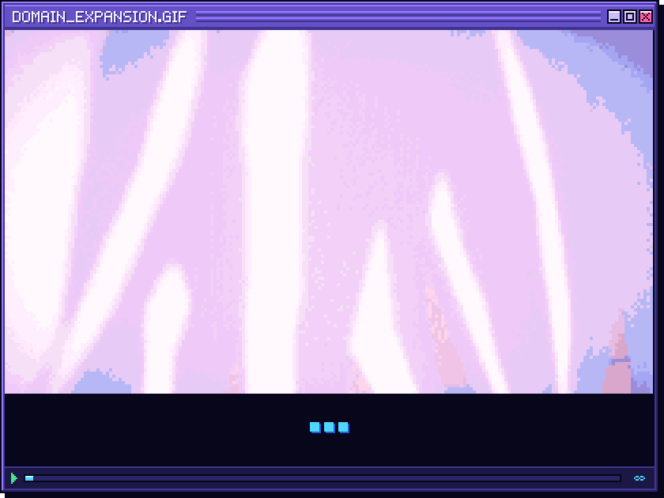

<p align="center">
  
</p>

<p align="center">
  
</p>

<p align="center">
  
</p>

<details>
<summary><b>OPEN SORCERER FILE</b></summary>
<br/>

```yaml
name: Quoc Huy
located_in: Ho Chi Minh, Viet Nam
current_job: AI engineer
education:
  [
    "Self-Taught Developer",
    "Bachelor's in Computer Science",
  ]

fields_of_interest:
  [
    "Artificial Intelligence",
    "Data Science",
    "Deep Learning",
    "Machine Learning"
  ]

currently_learning: ["LLMs", "Computer Vision", "Reinforcement Learning", "MLOps"]
goals: ["Publish 2+ papers and learn at least 5-10 new technologies."]
hobbies: ["Gaming", "Cinema", "Anime", "Judo"]
```

</details>

<p align="center">
  
</p>

<p align="center">
  
</p>

<p align="center">
  
</p>

<p align="center">
  
</p>

<p align="center">
  
</p>

<p align="center"><sub>© 2026 Quoc Huy · All rights reserved · See <a href="LICENSE">LICENSE</a></sub></p>
